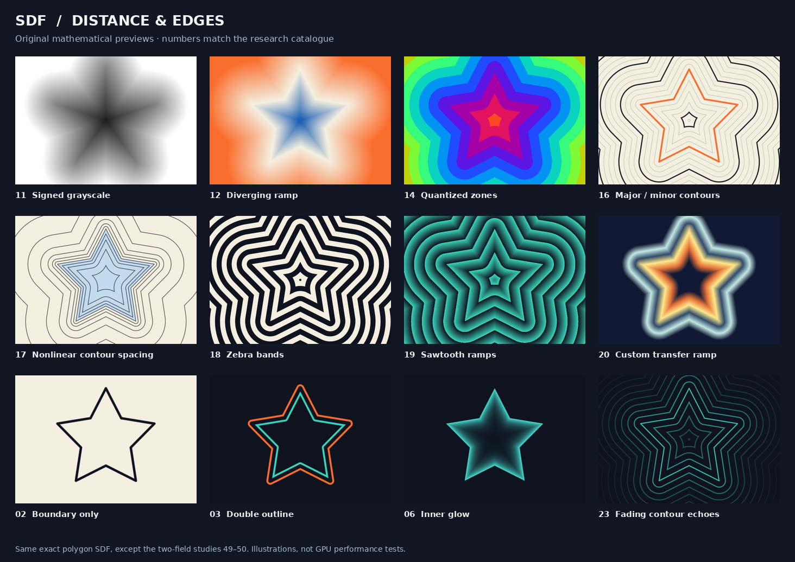
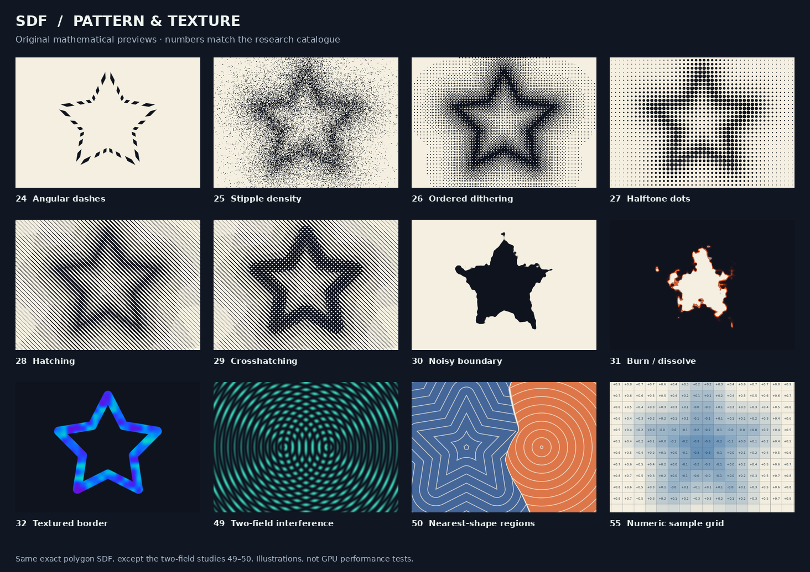
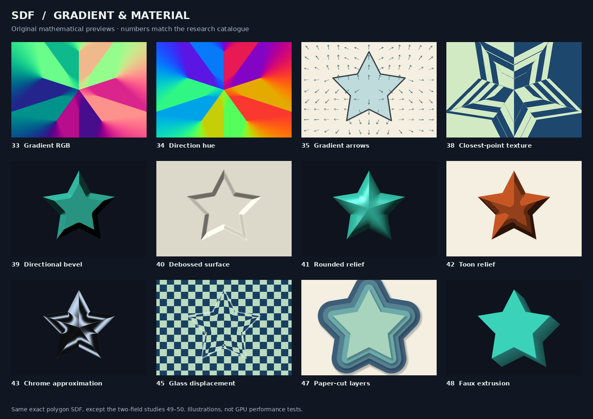

https://mini.gmshaders.com/p/sdf

there are signed distance fields so called SDF  functions in shadertoy. 

they give you back a distance to a certain point from the current pixel.

there are already example images of different styles how to visualize a sdf. 
please do research and find as many more different styles to visualize sdf values.

---

# Research: ways to visualize signed distance fields

Researched on 2026-10-19. **60 visualization recipes, with 36 original previews and links to illustrated primary sources.** This is a catalogue of established effects and explicitly marked adaptations, not a claim that there are 60 independent rendering algorithms. Several recipes are useful variations within a family.

An SDF returns the signed distance from a sample position to the **nearest shape boundary**, not generally to a fixed point. This document uses `d < 0` inside, `d = 0` on the boundary, and `d > 0` outside. Texture encodings sometimes reverse the sign or store the boundary at `0.5`; decode them before applying the recipes. [GM Shaders introduction][gm], [Valve paper][valve]

## Visual atlas

These are original numerical illustrations, not copied screenshots. Most use exactly the same star-shaped polygon SDF so that the rendering treatment is the variable. Studies 49–50 use two shapes. The captions correspond to catalogue numbers below.



[Download distance/edge plate as PDF](previews/01-distance-and-edges.pdf).



[Download pattern/texture plate as PDF](previews/02-pattern-and-texture.pdf).



[Download gradient/material plate as PDF](previews/03-gradient-and-material.pdf).

Individual previews are in [previews/](previews/). Reproduce all plates with `python3 hgc/sdf/render_style_atlas.py` from the project root; the [renderer](render_style_atlas.py) requires NumPy and Pillow. These are static CPU reference illustrations. The catalogue also includes animation and 3D ideas that are not rendered in these plates.

## What is already represented locally

| Existing reference | Visual treatment already present |
| --- | --- |
| [image.png](image.png) | Signed inside/outside colors, repeated contours, boundary highlight, distance falloff. The panels also change the geometry. |
| [image copy.png](image%20copy.png) | Overlaid fields/construction curves and an outlined shape. |
| [image copy 2.png](image%20copy%202.png) | Continuous distance colors with repeated isolines. |
| [image copy 3.png](image%20copy%203.png) | Luminous boundary and fading monochrome contour bands. |
| [image copy 4.png](image%20copy%204.png) | Two shapes, signed regions, and contours of a combined scalar field. The displayed formula is not necessarily a true distance. |

The current [visualization templates](../app/templates.js) also include silhouette, luminous contours, neon, a cosine heatmap, and gradient colors. These five families are marked **Existing** below. Their presence is not counted as a new discovery. Changing a circle to a star, applying a union, or warping coordinates changes the field; it does not by itself define a new visualization style.

## How to read the catalogue

- **Shown**: the cited author's article, documentation, or example demonstrates the effect. A preview here is still our own illustration, not a reproduction of that author's output.
- **Adaptation**: a proposed recipe derived from the stated math or linked technique. The source supports the ingredients, not necessarily this exact SDF treatment.
- **Existing**: already represented by a local visualization template.

Input notation: **D** = distance value; **P** = sample position; **G** = gradient/neighboring samples; **T** = time; **X** = texture or procedural pattern; **M** = multiple fields or shifted samples; **R** = ray integration or additional rendering machinery.

`p` denotes position, `sdf(p)` the field, `g = ∇d`, `n = g / max(length(g), ε)`, `a > 0` a distance scale, `w > 0` a half-width, and `s > 0` a period. Formulas are recipe sketches; thresholds need antialiasing for actual rendering.

### 1. Edges, fills, light, and shadow

| # | Style | Visual rule | Inputs | Evidence |
| --- | --- | --- | --- | --- |
| 01 | Flat silhouette | Fill `d < 0`; antialias the boundary. | D | **Shown · Existing** — [Valve][valve] |
| 02 | Boundary-only line | Display only `abs(d) < w`. | D | **Shown** — [Valve][valve] |
| 03 | Double / nested outline | Combine narrow bands centered at two or more selected distances. | D | **Adaptation** of 02 |
| 04 | Inner or outer stroke | Restrict an outline to the interior or exterior. | D | **Shown** — [Cyanilux][cyan] |
| 05 | Feathered silhouette | Spread the fill transition across a chosen distance interval. | D | **Shown** — [Valve][valve] |
| 06 | Inner glow | Light the interior near its boundary, fading inward. | D | **Shown** — [Cyanilux][cyan] |
| 07 | Outer halo | Fade light into the exterior with increasing distance. | D | **Shown** — [Valve][valve] |
| 08 | Neon tube | Combine a narrow bright core with a wider colored halo. | D | **Shown · Existing** — [ShaderFun 7][sf7] |
| 09 | Drop shadow | Shade a displaced field behind the foreground fill. | D, P, M | **Shown** — [ShaderFun 7][sf7] |
| 10 | Inner shadow / inset | Mask a displaced underlay to the shape interior. | D, P, M | **Shown** — [TextMesh Pro][tmp] |

### 2. Distance maps and contour structures

| # | Style | Visual rule | Inputs | Evidence |
| --- | --- | --- | --- | --- |
| 11 | Signed grayscale | Map `clamp(0.5 + d/(2*a), 0, 1)` to brightness. Midgray marks zero. | D | **Shown** — [Valve distance texture][valve] |
| 12 | Diverging distance ramp | Use distinct colors for opposite signs, with a neutral color at zero. | D | **Adaptation** of [diverging colormaps][maps] |
| 13 | Cyclic / cosine color bands | Evaluate a periodic RGB palette at scaled distance. Color repeats, so magnitude is ambiguous. | D | **Existing** — [local heatmap template](../app/templates.js) |
| 14 | Quantized distance zones | Color `floor(d/s)` as discrete terraces instead of a continuous ramp. | D | **Adaptation** of scalar color mapping |
| 15 | Repeating isolines | Draw thin bands at `d = k*s`, usually with the zero contour emphasized. | D | **Shown · Existing** — [GM Shaders][gm] |
| 16 | Major/minor contour map | Thin lines every `s`, heavier lines every `5*s`; optionally label distances. | D; labels need P | **Adaptation** of 15 |
| 17 | Nonlinear contour spacing | Select geometrically spaced levels, or contour `sign(d)*log(1+abs(d)/a)`. | D | **Adaptation**; concentrates detail near zero |
| 18 | Zebra / alternating bands | Threshold `sin(2π*d/s)` into alternating dark and light areas. | D | **Adaptation** of periodic field mapping |
| 19 | Sawtooth / beveled-looking bands | Map `fract(d/s)` to brightness; each band ramps then resets. | D | **Shown** — [Book of Shaders: Shapes][shapes] |
| 20 | Custom edge transfer texture | Use distance to index an artist-defined color/opacity strip. | D, X | **Shown** — [ShaderFun 7][sf7] |

### 3. Motion and broken contours

| # | Style | Visual rule | Inputs | Evidence |
| --- | --- | --- | --- | --- |
| 21 | Traveling pulse / expanding front | Draw a band around `d = r(t)`; vary its radius over time. | D, T | **Adaptation** of 02 |
| 22 | Moving contour train | Animate the phase of `sin(2π*d/s - phase)`. | D, T | **Adaptation** of 15; local luminous contours already animate |
| 23 | Fading contour echoes | Multiply repeated lines by `exp(-k*abs(d))`. Static or animated. | D, optional T | **Adaptation**; similar to a supplied reference |
| 24 | Dashes / marching ants | Gate a contour with a second repeating coordinate. Angle works for simple radial layouts. | D, P, optional T | **Adaptation** of [pattern tiling][patterns] |

For 24, `atan(p.y,p.x)` does **not** give uniform dash lengths around an arbitrary shape. Uniform contour dashes require a boundary coordinate such as arc length. One scalar distance cannot tell you where you are *along* an isoline.

### 4. Print, texture, and erosion treatments

| # | Style | Visual rule | Inputs | Evidence |
| --- | --- | --- | --- | --- |
| 25 | Stippling | Let a distance-derived intensity control random dot density. | D, P, X | **Adaptation**; e.g. compare noise with `exp(-k*abs(d))` |
| 26 | Ordered dithering | Compare that intensity with a repeating Bayer threshold matrix. | D, P, X | **Adaptation**; a deliberately visible pixel pattern |
| 27 | Halftone dots | Sample distance per cell; use its mapped intensity to set dot area. | D, P | **Adaptation** of [repeated shader cells][patterns] |
| 28 | Engraving / hatching | Vary stripe coverage or spacing with distance. | D, P | **Adaptation** of [line patterns][noise] |
| 29 | Crosshatching | Add differently oriented hatch layers at successive distance/intensity thresholds. | D, P | **Adaptation** of 28 |
| 30 | Rough / eroded boundary | Render `d + amplitude*noise(p)` with an edge or fill rule. | D, P, X | **Shown** — [ShaderFun 8][sf8] |
| 31 | Burn / dissolve edge | Animate a noisy threshold; add a bright narrow band at the disappearing edge. | D, P, X, T | **Adaptation** of 30 and 08 |
| 32 | Textured face or border | Use an SDF mask to confine a material or moving pattern to a fill/stroke. | D, P, X, optional T | **Shown** — [TextMesh Pro][tmp] |

Noise-modified values in 30–31 generally cease to be exact distances. They remain useful for making images, but their units and safe ray-marching steps need separate consideration. [ShaderFun 8][sf8]

### 5. Directions, flows, and nearest-point structure

| # | Style | Visual rule | Inputs | Evidence |
| --- | --- | --- | --- | --- |
| 33 | Gradient RGB | Encode the two components of `n` as color channels. | G | **Shown · Existing** — [ShaderFun 8][sf8] |
| 34 | Gradient-angle hue | Color according to `atan(n.y,n.x)`. | G | **Shown** — [ShaderFun 8][sf8] |
| 35 | Gradient arrows | Draw sparse arrows pointing along the gradient. | P, G | **Shown** — [ShaderFun 8][sf8] |
| 36 | Normal streamlines | Integrate curves through `n`; show paths crossing successive distance contours. | P, G, R | **Adaptation** of vector-field visualization |
| 37 | Tangent fibers / LIC | Filter noise along `(-n.y,n.x)` to make dense fibers following the contours. | P, G, X, R | **Adaptation** of [line integral convolution][lic] |
| 38 | Closest-point texture projection | Compute `q = p - d*g`; sample a pattern at `q` to extend boundary features outward. | D, P, G, X | **Adaptation** of [edge projection][sf8] |

The gradient points toward increasing signed distance: toward the boundary inside, and away from it outside. `p - d*g` reaches the closest boundary for an exact differentiable SDF with a unique closest point. Corners and medial axes can produce discontinuities. The discontinuities in previews 33–38 are intentional structural information, not simply bad color interpolation.

### 6. Relief and material illusions

| # | Style | Visual rule | Inputs | Evidence |
| --- | --- | --- | --- | --- |
| 39 | Directional bevel | Shade a narrow rim using the gradient and a light direction. | D, G | **Shown** — [ShaderFun 8][sf8] |
| 40 | Embossed / debossed surface | Turn the fill into a raised or recessed height profile and light its slopes. | D, G | **Adaptation** of bevel shading; preview shows a recess |
| 41 | Rounded / inflated relief | Use a curved height profile `h(d)` and compute its normal; add highlights. | D, G | **Adaptation** of height-based shading |
| 42 | Toon-shaded relief | Quantize the lighting of 41 into a few flat tones. | D, G | **Adaptation** of 41 |
| 43 | Chrome / reflective bevel | Use a bevel normal to sample an environment reflection. | D, G, X | **Shown** — [TextMesh Pro][tmp]; preview uses procedural studio bands |
| 44 | Fresnel-style rim | Map `pow(1-max(dot(N,V),0), power)` on a relief surface to brightness. | D, G | **Adaptation**; `N` is a 3D relief normal, `V` a view direction |
| 45 | Glass-like background displacement | Offset background UVs along the gradient, strongest near the edge. | D, P, G, X | **Adaptation**; a 2D refraction illusion, not physical glass |
| 46 | Spatially varying soft focus | Vary the softness of the SDF stroke across the image. | D, P; optional M | **Shown** — [Codrops SDF lens blur][lens]; this adjusts the mask rather than blurring a whole scene |
| 47 | Paper-cut layers | Stack discrete offset fills with displaced soft shadows. | D, P, M | **Adaptation** of 14 and 09 |
| 48 | Faux extrusion / long shadow | Composite a sequence of shifted silhouettes, then place the original face on top. | D, P, M | **Adaptation** of 09; the shifts must overlap to avoid gaps |

A 2D SDF does not uniquely define a 3D object. These material treatments introduce a chosen height profile or other artistic assumptions. Changing that profile is what changes a chamfer into a rounded edge or recess. Gradient discontinuities can remain visible in the highlights.

### 7. Multiple-field compositions

| # | Style | Visual rule | Inputs | Evidence |
| --- | --- | --- | --- | --- |
| 49 | Interference / moiré | Multiply or add periodic bands from two fields: `cos(k*dA)*cos(k*dB)`. | D, M | **Adaptation**; an interference-like image, not a wave simulation |
| 50 | Nearest-shape regions | Give each nearest shape a color; draw the equality boundary and optional contours. | D, M | **Adaptation**; compare exterior distances for nonoverlapping shapes |

These need access to the constituent fields, not only their final `min`/`max` result. For overlapping solids, comparing signed distances is a field-ownership rule, not necessarily the same as choosing the nearest geometric boundary. The scalar `(A-B)/(A+B)` shown in a supplied image also needs a denominator guard and generally is not an SDF.

### 8. Diagnostic and scientific views

| # | Style | Visual rule | Inputs | Evidence |
| --- | --- | --- | --- | --- |
| 51 | Distance-quality / Eikonal error | Color `abs(length(∇d)-1)`; use a legend and an error scale. | G | **Adaptation** from the unit-gradient property |
| 52 | Medial-axis / ridge emphasis | Highlight interior changes in closest boundary or gradient direction. | D, G | **Adaptation**; a heuristic ridge image is not a robust skeleton extractor |
| 53 | Curvature map | Estimate `div(∇d/length(∇d))` and color the boundary by curvature. | D, G | **Adaptation**; requires derivatives of normals |
| 54 | Boundary-projection error | Project toward the boundary and color the residual `abs(sdf(q))`. | D, P, G, M | **Shown** — [ShaderFun 8][sf8] |
| 55 | Numeric sample grid | Show signed values in grid cells alongside their colors. | D, P; glyph rendering | **Shown** — [ShaderFun 2][sf2] |
| 56 | Height-surface plot | Plot `z = d(x,y)` as a colored surface or wireframe; zero height identifies the boundary. | D, P, R | **Adaptation** of scalar-field plotting |

For 51–54, exclude or distinguish singularities and numerical sampling error. An exact SDF is not differentiable everywhere. Curvature of an offset contour is also not generally equal to curvature of the original boundary; restrict 53 to a narrow boundary band when that is the desired measurement.

### 9. Larger rendering extensions

| # | Style | Visual rule | Inputs | Evidence |
| --- | --- | --- | --- | --- |
| 57 | Lit 3D surface via sphere tracing | March a camera ray against `sdf(vec3)` and shade the hit normal. | 3D D, G, R | **Shown** — [Jamie Wong, with Shadertoy examples][ray] |
| 58 | 2D soft-shadow lighting | March from the pixel toward a light; use clearance along the ray to estimate visibility. | D, P, M, R | **Shown** — [Ryan Kaplan][shadows], [Ronja][ronja] |
| 59 | Translucent shells / emissive volume | Turn a 3D distance into density, e.g. `exp(-abs(d)/a)`, and integrate color/opacity along a ray. | 3D D, R | **Adaptation**; requires volume integration, not just a surface hit |
| 60 | Particle disintegration | Use an SDF/MSDF shape mask to control material breakup and matching particles. | D, P, X, T, R | **Shown** — [Codrops gommage effect][particles]; particles need a separate rendering/simulation path |

Entries 57–60 are included for breadth. They are not all direct replacements for the current `shade(vec2 p, float d)` function. In particular, 57 and 59 require a 3D field; 60 needs particle data/rendering.

## Useful implementation building blocks

The following GLSL sketches are original implementations of the mathematical recipes. They assume a fragment shader with derivatives available, an existing `float sdf(vec2 p)`, and negative-inside distances. They are not installed application templates.

```glsl
// About one pixel of transition, measured in the same units as d.
float aaWidth(float d) {
    return max(0.5 * fwidth(d), 1e-6);
}

float fillMask(float d) {
    float aa = aaWidth(d);
    return 1.0 - smoothstep(-aa, aa, d);
}

// halfWidth and level are measured in field units.
float contourMask(float d, float level, float halfWidth) {
    float aa = aaWidth(d);
    return 1.0 - smoothstep(halfWidth - aa, halfWidth + aa,
                            abs(d - level));
}

float contourTrain(float d, float spacing, float halfWidth) {
    float s = max(spacing, 1e-5);
    float nearestLevelDistance = abs(mod(d + 0.5 * s, s) - 0.5 * s);
    float aa = aaWidth(d); // Compute on the continuous field, before mod/abs.
    return 1.0 - smoothstep(halfWidth - aa, halfWidth + aa,
                            nearestLevelDistance);
}

vec2 sdfGradient(vec2 p, float e) {
    // e must be positive and expressed in p's coordinate system.
    return vec2(
        sdf(p + vec2(e, 0.0)) - sdf(p - vec2(e, 0.0)),
        sdf(p + vec2(0.0, e)) - sdf(p - vec2(0.0, e))
    ) / (2.0 * e);
}

// Given h = height(d), dhdd is the derivative of the chosen height profile.
vec3 reliefNormal(vec2 gradient, float dhdd) {
    return normalize(vec3(-dhdd * gradient, 1.0));
}
```

Some compact combinations:

| Treatment | Starting formula |
| --- | --- |
| Inner glow | `fillMask(d) * exp(-k * abs(d))` |
| Outer glow | `(1.0 - fillMask(d)) * exp(-k * abs(d))` |
| Double outline | Combine `contourMask(d, -offset, w)` and `contourMask(d, offset, w)` with different colors. |
| Signed diverging color | Blend a negative color into a neutral center, then into a positive color, over fixed distance limits. |
| Stipple | Compare a stable position-based random value with a distance-derived intensity. |
| Rounded relief | One possible profile is `h(d) = H*(1-exp(min(d,0)/a))`; inside, `dh/dd = -(H/a)*exp(d/a)`. |
| Approximate projection for a non-distance implicit field | Newton-style step `q = p - d*g/max(dot(g,g), epsilon)`; iterate if needed. This is a root-finding step, not a guarantee of the closest point. |

Antialiasing an individual contour does not solve undersampling of a dense contour train. Fade toward average coverage when spacing becomes smaller than the pixel footprint. Ordered dithering and dot patterns likewise need export-resolution checks. Use strictly ordered `smoothstep` edges; `smoothstep(a,b,x)` with `a >= b` is not a portable inverse ramp.

For seamless periodic animations, drive the phase with `2π*u_time/u_duration`. A single nonperiodic moving threshold will jump when time wraps unless it is faded out at the ends or given a periodic trajectory. Keep noise deterministic or explicitly looped when exporting frames.

## Best places to browse real examples

These links are to authors' implementations, official documentation, or research. Their effect descriptions were checked during this research; linked interactive demos were not all run in a browser.

| Source | What to inspect |
| --- | --- |
| [ShaderFun 7 — Some Simple Effects][sf7] | Illustrated soft borders, neon, custom edge-color strips, and drop shadows. |
| [ShaderFun 8 — Gradients, Bevels and Noise][sf8] | Gradient visualizations, bevels, noisy shapes, and projection diagnostics. |
| [TextMesh Pro distance-field shaders][tmp] | Face/outline textures, inner underlays, bevel lighting, bump maps, and environment reflections. |
| [Cyanilux — Sprite Glow/Outline][cyan] | Inner/outer effect placement with shader-graph illustrations. |
| [Valve — Improved Alpha-Tested Magnification][valve] | Figures 2 and 4–7: distance texture, soft edges, outlines, halo, and shadow. |
| [Red Blob Games — Distance Field Effects][redblob] | Side-by-side rounded versus sharp outline behavior for SDF and MSDF. |
| [Rubén Torres's SDF sandbox][sandbox] | An implementation with editable effect parameters; [live playground][sandbox-live]. |
| [The Book of Shaders — Shapes][shapes] | Editable distance-field, repeated-ramp, and contour experiments. |
| [Ryan Kaplan — Ray Marching Soft Shadows in 2D][shadows] | Interactive examples explaining clearance-based soft shadows. |
| [Ronja — 2D SDF Shadows][ronja] | A complete 2D shadow shader and adjustable softness. |
| [Jamie Wong — Ray Marching and SDFs][ray] | Embedded Shadertoy examples from silhouettes to lit 3D scenes. |
| [Codrops — SDF Lens Blur][lens] | A spatially softened outline treatment; [live demo][lens-live]. |
| [Codrops — Gommage Effect][particles] | MSDF text dissolving into dust and petals. |
| [ShaderFun 2 — Solid Geometry][sf2] | Signed numeric cells and inside/outside visualization. |
| [Matplotlib — Choosing Colormaps][maps] | Sequential, diverging, and cyclic mappings; useful for choosing a meaningful legend. |
| [The Book of Shaders — Patterns][patterns] | Repeated cells and coordinate patterns for proposed dashes/dots. |
| [The Book of Shaders — Noise][noise] | Procedural noise and line-texture ingredients for proposed surface treatments. |
| [Forssell — Flow Visualization Using LIC][lic] | Vector-field texture visualization; applying it to SDF tangents is our proposed adaptation. |
| [GM Shaders — Signed Distance Fields][gm] | The original reference and baseline contour visualizations. |

Inigo Quilez's [2D distance-function reference](https://iquilezles.org/articles/distfunctions2d/) is linked by several authors and remains useful background. Direct access to that site was blocked by robots.txt in this research session. Shadertoy embeds also could not be inspected directly; the linked author tutorials provide the accessible explanations. No unseen Shadertoy shader is presented here as independently verified.

## Suggested first additions for this project

For the largest visible change from the five existing templates, start with **halftone (27), hatching (28), bevel (39), paper-cut layers (47), noisy dissolve (31), and closest-point texture projection (38)**. These explore different uses of the field instead of only changing a contour palette.

The current `shade(vec2 p, float d)` interface can express most 2D recipes: additional calls to `sdf(p)` provide shifted samples and finite differences. Textures require sampler support or procedural substitutes. For two-field effects, expose both distances or define them in the visualization. Particle and 3D extensions require broader renderer changes.

For quantitative comparison, preserve a fixed distance range and a legend. Cyclic colors, stippling, chrome, and deliberately noisy fields are valuable artistic treatments but can obscure the magnitude or accuracy of the underlying distance. [Colormap guidance][maps]

[gm]: https://mini.gmshaders.com/p/sdf
[valve]: https://cdn.fastly.steamstatic.com/apps/valve/2007/SIGGRAPH2007_AlphaTestedMagnification.pdf
[sf2]: https://shaderfun.com/2018/03/25/signed-distance-fields-part-2-solid-geometry/
[sf7]: https://shaderfun.com/2018/07/01/signed-distance-fields-part-7-some-simple-effects/
[sf8]: https://shaderfun.com/2018/07/23/signed-distance-fields-part-8-gradients-bevels-and-noise/
[tmp]: https://docs.unity.cn/Packages/com.unity.textmeshpro%404.0/manual/ShadersDistanceField.html
[cyan]: https://www.cyanilux.com/tutorials/sprite-outline-shader-breakdown/
[shapes]: https://thebookofshaders.com/07/
[patterns]: https://thebookofshaders.com/09/
[noise]: https://thebookofshaders.com/11/
[maps]: https://matplotlib.org/stable/users/explain/colors/colormaps.html
[redblob]: https://www.redblobgames.com/blog/2024-03-27-distance-field-effects/
[sandbox]: https://github.com/ruben3d/sandbox-sdf
[sandbox-live]: https://ruben3d.github.io/sandbox-sdf/dist/
[shadows]: https://www.rykap.com/2020/09/23/distance-fields/
[ronja]: https://www.ronja-tutorials.com/post/037-2d-shadows/
[ray]: https://jamie-wong.com/2016/07/15/ray-marching-signed-distance-functions/
[lic]: https://graphics.stanford.edu/papers/flowvis/
[lens]: https://tympanus.net/codrops/2024/06/12/shape-lens-blur-effect-with-sdfs-and-webgl/
[lens-live]: https://tympanus.net/Tutorials/SDFLensBlur/
[particles]: https://tympanus.net/codrops/2026/01/28/webgpu-gommage-effect-dissolving-msdf-text-into-dust-and-petals-with-three-js-tsl/
