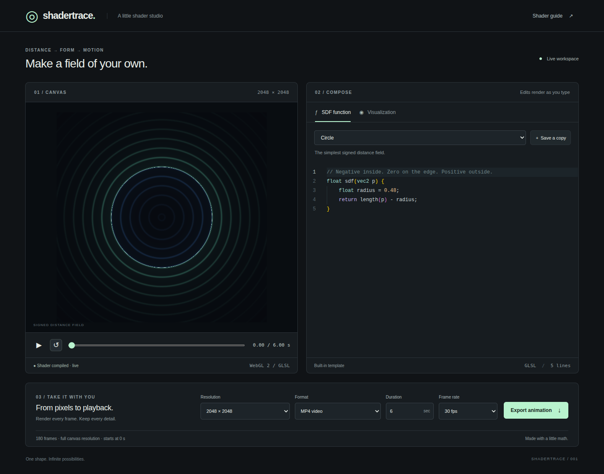
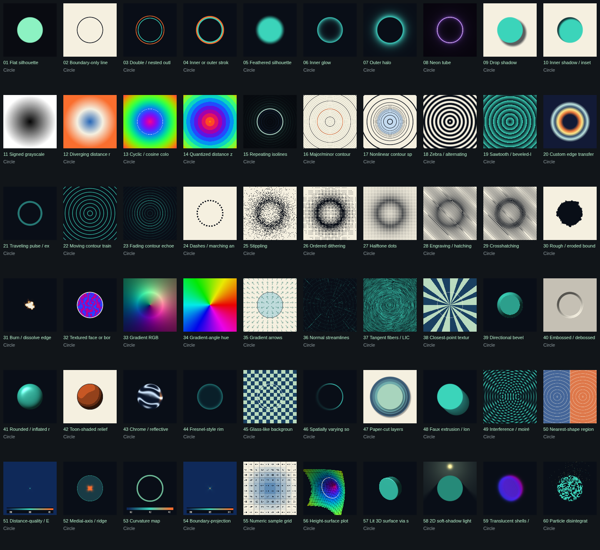

# Shadertrace

**Make something you want to watch again.**

Start with a simple shape. Watch it glow, ripple, take on the sheen of chrome, or drift apart into particles. Change one detail, discover a different mood, and follow that little “what if?” a bit further.

Shadertrace is a small creative studio for turning shapes into moving artwork. Pick a look, make it your own, and take the result with you.

*Your next idea, taking shape in real time.*

## One shape. Sixty moods.

Quiet pencil hatching. Crisp paper-cut layers. Electric neon. Soft halos. Reflective surfaces. A cloud of drifting particles.

Explore **60 visual styles** and see how differently the same shape can feel. Start with something familiar, then try the treatment you would never have picked first. Sometimes that is the one worth keeping.

*Every image above starts with the same circle. Click to explore the full gallery.*

## Bring something that is yours

A mark you drew. A geometric sketch. A favorite outline.

Bring in an **SVG or DXF drawing** and explore what it could become in light, texture, and motion. Or begin with one of the built-in shapes and let curiosity choose the direction.

## Stay with the idea

See your changes as you make them. Pause on a frame that catches your eye. Scrub through the motion. Open the code and nudge a color, a curve, or a rhythm until it feels right.

Save the variations you love as reusable templates, ready for the next experiment. Your collection grows with your taste.

## Make it. Keep it. Share it.

Turn an experiment into a looping GIF, a moving backdrop, or a visual study for your next project. Export **GIF, MP4, or WebM** at the canvas resolution you choose, and give your creation somewhere to live beyond the editor.

## See where one shape takes you

Choose a shape. Try a style. Follow the surprise.

**[Get started with Shadertrace →](docs/guide.md#run)**

[Explore the visual style catalog](hgc/sdf/signed_distance_field.md) · [Setup and reference guide](docs/guide.md)
